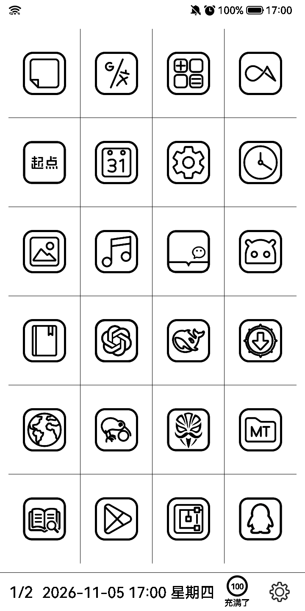
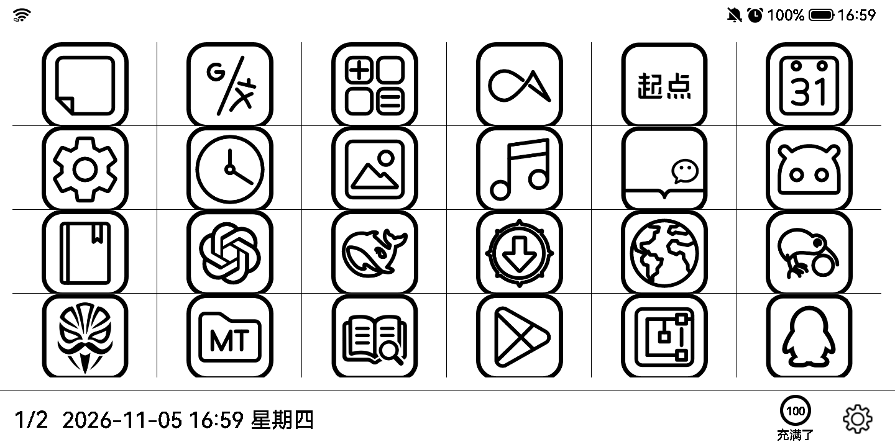
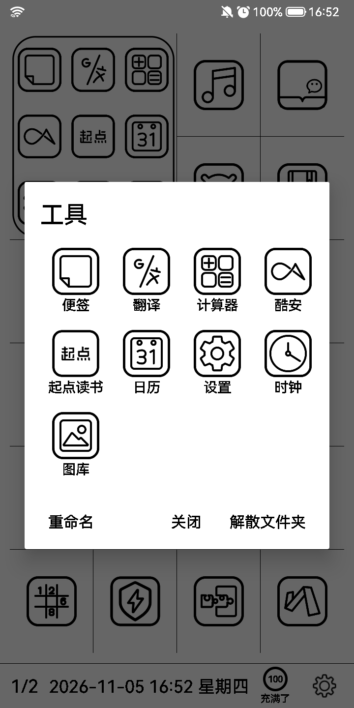

# E-Ink Launcher · 墨水屏桌面改造版

> 2×2 九宫格文件夹 · 自定义图标顺序 · 横屏自动换排

**成品 APK（debug 签名）**：[Releases](https://github.com/zuakeo/E-Ink-Launcher-Folders/releases/latest) → `E-Ink-Launcher-Folders-0.1.8.6-folders6.apk`



---

## 0. 先说清楚：这是拿谁的作品改的

| | |
|---|---|
| **原作者** | [Modificator](https://github.com/Modificator) |
| **上游仓库** | https://github.com/Modificator/E-Ink-Launcher |
| **上游分支/版本** | `master`，`versionName 0.1.8.6` / `versionCode 30`（基线提交 `155738c feat: 添加应用排序设置`） |
| **许可证** | Apache License 2.0（上游 `LICENSE` 原样保留在本仓库） |
| **本仓库** | 在上述源码基础上的**修改版（fork）**，同样以 Apache-2.0 发布 |

**我没有从零写这个桌面。** 网格布局、应用列表、翻页手势、设置页、FTP 服务、锁屏、图标主题这些基础能力
全部来自 Modificator 的 E-Ink Launcher。本仓库只做了下面第 1 节列出的增量改动，
按 Apache-2.0 §4(b) 的要求，改动过的文件都在文件头和 `NOTICE` 里标注了。

> 原项目是为墨水屏电纸书设计的启动器，这个 fork 是给一台**海信墨水屏手机**
> （HITV205N / Android 11 / 720×1440 / 竖屏 4 列 6 行）用的，
> 所以你会看到很多“为这块屏”做的取舍（纯黑白、不做动画、点击优先于滑动等）。

---

## 1. 改了什么（相对上游 0.1.8.6）

### 1.1 文件夹：占 2×2 格，里面是 3×3 九宫格

| 行为 | 说明 |
|---|---|
| 建立 | 长按应用 → 「移入文件夹…」→ 选已有文件夹或「＋ 新建文件夹」 |
| 外观 | 一个块里画 **3×3 共最多 9 个** 应用图标，白底黑框圆角；**默认不显示文件夹名**（设置里可开） |
| 点图标 | **直接启动那个应用**，不用先展开 |
| 点空白 | 点图标之间的缝隙、或九宫格外的留白 → 展开文件夹弹窗（4 列显示全部应用） |
| 弹窗内 | 点图标启动；长按 → 移出文件夹；底部：重命名 / 关闭 / 解散 |
| 自动清理 | 文件夹被移空、或应用被卸载光 → 文件夹自动消失 |

### 1.2 自定义图标顺序（手动排序）

- 设置 → 「**调整图标顺序**」进入排序模式：底部出现提示条
- **点第一个图标**（出现黑框）→ **再点目标格子** → 两格交换；选中状态跟着移动的图标走，可以连续挪
- 「完成」或返回键退出；顺序写进 `launcherFolders.xml`，重启保留
- 排序方式会自动切到「自定义顺序」，不会被名称排序冲掉
- 文件夹是 2×2 整块，也参与交换

### 1.3 横屏适配

- 竖屏按设置里的「列 × 行」（默认 4×6）；**横屏自动对调成 6×4**，不需要单独配置
- **图标顺序完全不变**：只改每页容量和折行位置
- 桌面自己接管 `configChanges` + `onConfigurationChanged`，旋转时**不重建 Activity**，不闪、不跳页

### 1.4 其它小改动

- 线条图标：`assets/icons/<包名>.png` 优先替换系统图标（见第 4 节说明）
- 修了上游遗留的翻页手势问题（见 2.5）
- 修了文件夹弹窗图标错位（见 2.6）

---

## 2. 怎么实现的

### 2.1 排版从“一格一项”改成“支持跨格”

上游的网格是**固定 `rowNum × colNum` 个等大格子**，第 i 个 View 就摆在第 i 格，没有跨格概念。

改造后引入 `AppDataCenter.Placement`：

```java
public static class Placement {
    public final ResolveInfo info;   // 这个条目是什么（应用或文件夹）
    public final int index;          // 在全局顺序里的下标
    public final int col, row;       // 起始格子
    public final int spanW, spanH;   // 跨度：普通应用 1×1，文件夹 2×2
}
```

分页用**首次适配（first-fit）装箱**：按顺序扫每一行、每一列，找第一个能放下 `span×span` 的空位；
放不下就换新页。这样 1×1 和 2×2 可以混排，页与页之间不会把文件夹切开。

```java
int[] findSlot(boolean[][] used, int span) {
    for (int r = 0; r + span <= rowNum; r++)
        for (int c = 0; c + span <= colNum; c++)
            if (区域全空) return new int[]{c, r};
    return null;   // 这一页塞不下，开新页
}
```

> 顺序与排版是两件事：`mApps` 是唯一的有序列表，换网格只是重新调用 `packPages()` 再算一次坐标，
> 所以**换行列数、换横竖屏都不会打乱图标顺序**。

### 2.2 视图层按 span 布局

`EInkLauncherView`（继承 `ViewGroup`）原来按 `index % colNum` 算坐标，现在改成按 Placement：

```java
getChildAt(i).layout(
    p.col * cellW, p.row * cellH,
    (p.col + p.spanW) * cellW, (p.row + p.spanH) * cellH);
```

格线背景也按“这个块占了哪些格子”来选边：`app_item_normal / _right / _bottom / _final`
（分别裁掉上/左、右、下、右下的描边，避免格线重影、外圈不出线）。

### 2.3 文件夹图标是画出来的，不是拼布局

`FolderIconView` 继承 `View`，纯 `onDraw`：

- 先画一个白底黑边的圆角矩形（`canvas.drawRoundRect`）
- 再把最多 9 个 `Drawable` 按 3×3 等分画进去：算每格中心 → 算图标边长 → `drawable.setBounds()` → `draw()`
- 尺寸：`onMeasure` 里撑满 2×2 的可用高度（显示文件夹名时退回正方形，给文字留位置）

这样做的好处：不用为了一个文件夹去 inflate 9 个 ImageView；墨水屏没有动画/阴影需求，一次绘制完成。

### 2.4 点图标启动 vs 点空白展开

`FolderIconView.onTouchEvent` 自己做命中判断：

```java
// 只认图标实际绘制范围（不带容差），格子之间的空隙算“空白”
float reach = iconSize / 2f;
for (int i = 0; i < keys.size(); i++)
    if (|x-cx| <= reach && |y-cy| <= reach) return i;   // 命中第 i 个图标
return -1;                                              // 空白
```

命中 → `callback.onFolderChildClick(条目键)` → 桌面用 `ComponentName` 直接 `startActivity`；
没命中 → 打开文件夹弹窗。九宫格之外（2×2 的留白）由父 View 的点击事件打开弹窗，
所以即使 9 格全满，也还有地方能展开。

### 2.5 翻页手势（上游遗留问题）

上游只在 `ACTION_UP` 判断滑动方向。但 `EInkLauncherView` 是纯 `ViewGroup`，
**空白格子上按下时没人消费事件**，系统就不再派发后续 MOVE/UP —— 第 2 页空位多，从空白处起手必然划不回第 1 页。

修法：

1. `onTouchEvent` 直接 `return true`，让网格自己成为触摸目标
2. 翻页改在 **ACTION_MOVE 越过阈值时**就触发（不等抬手）
3. 同时给子 View 发 `ACTION_CANCEL`，避免滑动结束时误触图标；用 `swipeHandled` 吞掉剩余事件

### 2.6 文件夹弹窗图标错位（自己踩的坑）

`LineIcons` 一开始缓存的是 `Drawable` **实例**。九宫格是用 Canvas 手画的，会给 drawable
`setBounds(自己的格子)`；弹窗再拿同一个实例塞给 `ImageView`，`ImageView` 就带着那份
“别人的 bounds”去画 —— 于是出现图标偏移、缩放不对、被裁切。

修法：**只缓存 `Bitmap`，每次 `new BitmapDrawable(res, bitmap)`**（共享位图，开销可忽略）。

### 2.7 持久化

两套 `SharedPreferences`，都是 JSON：

```
shared_prefs/launcherPropertyFile.xml   # 行列数 / 字号 / 隐藏应用 / 排序方式 / 文件夹名开关
shared_prefs/launcherFolders.xml        # {"folders":[{"id","name","items":[...]}], "order":[...]}
```

条目键统一带前缀，便于区分：

```
p|<包名>|<Activity>    普通应用
f|<文件夹id>           文件夹
```

### 2.8 横屏

```java
int cols = isLandscape() ? config.getRowNum() : config.getColNum();
int rows = isLandscape() ? config.getColNum() : config.getRowNum();
launcherView.configure(cols, rows, config.isHideDivider());
dataCenter.setGridSize(cols, rows);   // 重新装箱，顺序不变
```

Manifest 里给 `Launcher` 加
`configChanges="orientation|screenSize|screenLayout|smallestScreenSize|keyboardHidden"`，
旋转走 `onConfigurationChanged()` 就地换网格，不重建界面。

### 2.9 改动文件清单

| 文件 | 性质 |
|---|---|
| `model/FolderStore.java` | 新增：文件夹 + 手动顺序持久化 |
| `model/AppDataCenter.java` | 重写：Placement / 装箱 / 文件夹条目 / 手动排序 |
| `widgets/EInkLauncherView.java` | 重写：支持跨格布局、修翻页手势 |
| `widgets/FolderIconView.java` | 新增：九宫格绘制 + 命中判断 |
| `widgets/LauncherAdapter.java` | 改：数据从 `List<ResolveInfo>` 换成 `List<Placement>` |
| `widgets/AppItemBinder.java` | 改：文件夹绑定、排序模式、图标替换 |
| `FolderDialog.java` | 新增：文件夹弹窗 |
| `LineIcons.java` | 新增：assets 线条图标 |
| `Launcher.java` | 改：菜单、弹窗、排序模式、横竖屏网格 |
| `SettingFragment.java` / `res/layout/activity_setting.xml` | 改：加两个设置项 |
| `Config.java` | 改：加 `launcherShowFolderName` |
| `res/layout/launcher_item.xml` | 改：加 `folderImage` / `selectBox` |
| `res/layout/launcher_activity.xml` | 改：加排序模式提示条 |
| `res/values*/arrays.xml` / `strings.xml` | 改：自定义顺序、新文案 |
| `AndroidManifest.xml` | 改：`configChanges` |

---

## 3. 在什么设备上做的、测过什么

### 3.1 开发/测试设备

| 项 | 值 |
|---|---|
| 机型 | **海信 Hisense 墨水屏手机 HITV205N**（电子墨水屏 EPD） |
| 系统 | Android 11 |
| 屏幕 | 720 × 1440 物理像素，320 dpi（1dp = 2px） |
| 桌面网格 | 竖屏 **4 列 × 6 行**（本仓库作者的日常配置，可在设置里改） |
| 权限 | 已 Magisk root（仅为测试时用 adb + su 备份/还原 `shared_prefs`，**App 本身不需要 root**） |
| 编译环境 | Windows 11 + JDK 17.0.21 + Android SDK platform 36 / build-tools 36.0.0 + Gradle 9.1 |
| 安装方式 | `adb install -r`（debug 签名），`cmd package set-home-activity` 设为默认桌面 |

墨水屏的刷新特性（局部刷新、残影、`screencap` 有时拿到上一帧）在测试里反复出现，
所以下面的“验证”都是**按一下主页/翻一页触发重绘后**再截图确认的。

### 3.2 做过的测试

都是在这台机器上真机点出来的，测试手段是 `adb shell input`（点击/长按/滑动）+
`screencap` 截图 + `uiautomator dump` 读控件树核对坐标与文字。

| # | 测试项 | 结果 |
|---|---|---|
| 1 | 编译 `assembleDebug`、安装、设为默认桌面、重启后仍是默认桌面 | ✅ |
| 2 | 覆盖安装（`install -r`）保留原配置：4 列 6 行、字号 10、不显示应用名、12 个隐藏应用 | ✅ |
| 3 | 长按应用 →「移入文件夹…」→「＋ 新建文件夹」建文件夹 | ✅ |
| 4 | 文件夹占满 2×2，九宫格显示 9 个图标，图标大小/间距均匀 | ✅ |
| 5 | 点九宫格里的图标 → **直接启动对应 App**（点「便签」进备忘录、点「翻译」进翻译） | ✅ |
| 6 | 点图标之间的缝隙 / 九宫格外的留白 → 展开文件夹弹窗（9 格全满时也能展开） | ✅ |
| 7 | 弹窗内 4 列显示全部应用（测过 9 个、14 个、15 个的文件夹），点图标启动并关闭弹窗 | ✅ |
| 8 | 弹窗内长按 → 移出文件夹：该应用回到桌面且排在文件夹后面，九宫格自动补成 3+3+2 | ✅ |
| 9 | 重命名、解散文件夹（应用全部放回桌面）、移空后文件夹自动消失 | ✅ |
| 10 | 设置「显示文件夹名称」开/关：开→九宫格下显示一行名字，关→不显示 | ✅ |
| 11 | 「调整图标顺序」：点一个图标出现黑框 → 点目标格 → 两格互换；`完成`/返回退出 | ✅ |
| 12 | 顺序持久化：改完重启桌面，顺序保持 | ✅ |
| 13 | 翻页：第 1 页 ↔ 第 2 页来回划；从**空白格子**起手也能翻；滑动结束不会误启动 App | ✅ |
| 14 | 横屏：4×6 自动变 6×4，顺序与前 6 个图标完全一致；转回竖屏恢复 4×6 | ✅ |
| 15 | 文件夹弹窗图标错位 bug 修复后复测：9 个图标全部对齐、大小一致 | ✅ |
| 16 | 卸载重装 / 覆盖安装后 App 不崩、无 ANR | ✅ |

### 3.3 没测过 / 不保证的

- 除 HITV205N 以外的任何机型、分辨率、dpi（尤其高刷彩屏、平板、折叠屏）
- 横屏下的文件夹（2×2 在 6×4 里的排布）、横屏下的排序模式
- 一个文件夹里超过 15 个应用的分页表现（第 10 个以后只在弹窗里滚动查看）
- 系统深色模式、动态取色、图标包主题（本改造只做黑白）
- 上游自带的 FTP 服务、锁屏、崩溃上报等模块（我没有改动，也没专项测）
- 非 Android 11 的权限模型（`targetSdk 36`）

---

## 4. 截图

| 竖屏 4×6 | 横屏 6×4 | 文件夹弹窗 |
|---|---|---|
|  |  |  |

---

## 5. 编译

需要 JDK 17 + Android SDK（platform 36 / build-tools 36）+ Gradle 9.1（用 wrapper 即可）。

```bash
git clone <this-repo>
cd <repo>
# local.properties 里写 sdk.dir=你的 Android SDK 路径
./gradlew assembleDebug
# 产物 app/build/outputs/apk/debug/app-debug.apk
```

装到机器（本文作者的机器是海信墨水屏手机，Android 11，已 root）：

```bash
adb install -r app/build/outputs/apk/debug/app-debug.apk
adb shell cmd package set-home-activity cn.modificator.launcher/.Launcher
```

### 一键同步（作者自用）

仓库根目录带了 `sync.sh`，改完代码不用记一堆命令：

```bash
./sync.sh "这次改了什么"            # 编译 + 提交 + 推送到 GitHub
./sync.sh --no-build "只改了文档"   # 跳过编译
./sync.sh --release "本次改动要点"  # 升版本 + 编译 + 改 README + 推送 + 发 Release
./sync.sh --dry-run "看看会做什么"  # 只打印计划，不动仓库
```

它会：编译前先确认 JDK / 失败就中止（不会推半成品）→ 提交 → 推 `publish` 分支 →
`--release` 时自动把 `versionCode` / `versionName` 各加一、更新 README 的下载链接和变更记录、
建 tag、走 REST API 发 Release 并上传 APK（`gh release create` 会因 token 缺 `workflow` scope 失败，所以绕开）。
APK 只进 Release 不进 git（`.gitignore` 里有 `*.apk`）。

### 关于线条图标

`app/src/main/assets/icons/*.png` 是从 [Arcticons](https://github.com/Donnnno/Arcticons)（CC BY-SA 4.0）
下载线条图标、统一加圆角外框渲染出来的，**按包名命名**。
代码本身不依赖这些文件：**缺哪张就自动回退成系统图标**。
想换成自己的图标，直接把 `包名.png` 丢进这个目录即可。

---

## 6. 已知限制

- 只在**海信 HITV205N（Android 11，720×1440，320dpi）** 上验证过，其它机型/分辨率没测
- 横屏下格子是 233×135（宽而矮），图标会被格子高度撑得比较满
- 文件夹最多预览 9 个，第 10 个以后只在弹窗里可见
- 个人自用改造，没有做多语言（界面中文为主，英文串沿用上游）
- 上游遗留：`targetSdk 36` 但很多逻辑按旧 API 写，换新系统可能要注意权限

## 7. 变更记录

| 版本 | 内容 |
|---|---|
| 0.1.8.6-folders6 | 横屏 4×6 → 6×4，顺序不变 |
| 0.1.8.6-folders5 | 修文件夹弹窗图标 bounds 串台导致的错位/裁切 |
| 0.1.8.6-folders4 | 文件夹撑满 2×2；移出应用不再整页重排；图标命中收紧，缝隙可展开 |
| 0.1.8.6-folders3 | 修空白处起手无法翻回上一页 |
| 0.1.8.6-folders2 | 文件夹改 2×2 + 九宫格直接启动 + 文件夹名开关 |
| 0.1.8.6-folders1 | 文件夹（1 格）+ 自定义图标顺序 |

---

## 8. 致谢与许可

- 全部基础代码来自 **[Modificator/E-Ink-Launcher](https://github.com/Modificator/E-Ink-Launcher)**，作者 **Modificator**，Apache-2.0
- 线条图标来自 **[Arcticons](https://github.com/Donnnno/Arcticons)**（CC BY-SA 4.0）
- 本项目按 **Apache License 2.0** 发布，见 [`LICENSE`](LICENSE)；修改说明见 [`NOTICE`](NOTICE)

---

## 9. 上游原始说明（保留）

`E-Ink Launcher` is an Android launcher for Electronic paper book.

- 上游仓库：https://github.com/Modificator/E-Ink-Launcher
- Telegram 群：https://t.me/EInkLauncher
